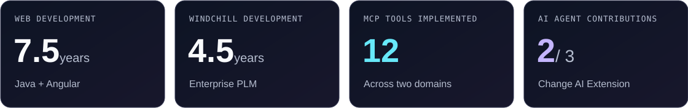
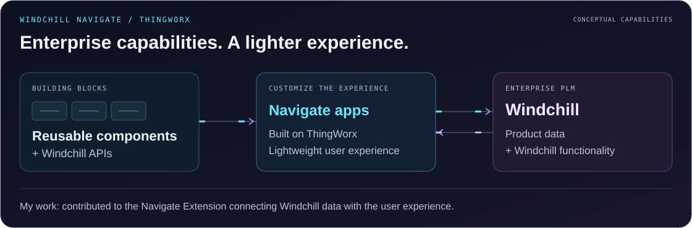

<!-- Publish this file as README.md at the root of your GitHub profile repository.
     Include all seven referenced SVGs from the assets folder at the same relative paths.
     SVG artwork is self-contained; the greeting GIF is hosted externally.
     SVG animations respect prefers-reduced-motion; the GIF does not.
     Essential details remain in text.
     Project graphics are conceptual, not deployment diagrams or live telemetry.
     The sorting animation illustrates one swap, not a complete sort or benchmark. -->

<h1>Hi , I'm Nitish.</h1>

<strong>Senior Software Specialist at PTC</strong>

<strong>7.5+ years building web applications. Java depth. Angular craftsmanship. End-to-end ownership.</strong>

Enterprise experience: <strong>4.5 years in PTC Windchill development</strong> · Product Lifecycle Management (PLM)

  <a href="https://portfolio.nitishhurduke.workers.dev/"><strong>Explore my work</strong></a>
  &nbsp; / &nbsp;
  <a href="https://www.linkedin.com/in/nitishhurduke/"><strong>Connect on LinkedIn  </strong> </a>
  &nbsp; / &nbsp;
  <a href="mailto:nitishhurduke@gmail.com"><strong>Build with me</strong></a>

---

### The space between a solid system and a great experience.

That's where I like to work.

My core is **Java and Spring Boot**, paired with **Angular and PostgreSQL**. I care about how a system is designed, how its data moves, and how the person on the other side experiences it. Backend depth and frontend polish shouldn't be separate ambitions.

At **PTC**, my work spans **[Windchill](https://www.ptc.com/en/products/windchill) PLM R&D**, **Windchill Navigate on ThingWorx**, **AI agents for Change Management**, and **MCP servers that connect AI clients to Windchill data**.

I bring **end-to-end ownership, system design, and mentoring** to my broader engineering work. I'm also building **agentic applications with Spring Boot**, connecting my Java background with practical AI integration.

## Selected professional work

### 01  Connect AI clients to enterprise Windchill data

**MCP server development · ProdMgmt & DocMgmt**  
PTC · Windchill

Contributed to building **Model Context Protocol (MCP) server capabilities for two Windchill domains: ProdMgmt and DocMgmt**. These enable MCP-compatible clients, including **Claude** and **GitHub Copilot in VS Code**, to retrieve domain-specific Windchill data in response to user requests.

**My implementation contributions:**

- **12 tools** across the two domains.
- **User details verification**.
- **License and credential checks**.
- **JSON-RPC error responses**.

The work connects agent-facing tools with enterprise data access, including the verification checks and explicit error responses needed around those requests.

### 02  AI agents for enterprise Change Management

**Change AI Extension · Windchill PLM R&D**  
PTC · Senior Software Specialist · November 2024–present

Contributed to building **two of the extension's three AI agents**:

- **PR Draft Agent:** turns an end user's problem description—for example, from a factory worker—into a well-formatted **Problem Report (PR)** in Windchill.
- **PR Validator Agent:** validates agent-drafted and existing Windchill Problem Reports against a **template configured by the Change Admin**, providing **completeness analysis** and **potential-duplicate analysis**. Duplicate indications are not confirmed matches.

**Engineering focus:** applying AI to report drafting and template-based validation within enterprise Change Management.

### 03  Connect enterprise data to the user experience

**Windchill Navigate Extension · ThingWorx**  
PTC · Software Specialist · May 2022–November 2024

Worked on the **Windchill Navigate Extension**, built on **ThingWorx**. Navigate exposes Windchill functionality through a **lightweight user experience**, with **reusable components and Windchill APIs** for building custom Navigate applications.

**Engineering focus:** connecting enterprise platform capabilities with a customizable user experience.

### 04  Document verification in a finance application

**CDL Lakshmi Finance - Furniture financing · Client project**  
IP Tech System · Software Engineer · January 2019–May 2022

Responsible for the **Document Verification module** in a client finance application for purchasing furniture on loan.

- Supported **KYC documents, loan sanction letters, disbursement letters**, and other loan-related documents.
- A **clerk personally reviews and approves documents**; the module fetches information from relevant **government APIs to support KYC validation**.
- Tracked verification as **pending, in progress, complete, or failed**. The process moves to the **Disbursement module only after verification is complete and all documents are approved**.

**Engineering focus:** role-based human review, API-assisted verification, and explicit workflow states—not automated document approval.

[**View my professional background on LinkedIn →**](https://www.linkedin.com/in/nitishhurduke/)

## Public work you can explore

### Make the invisible visible

 **Sorting Algorithm Visualizer** · Interactive demo

An Angular application that makes algorithm behavior something you can watch, control, and compare.

- Explore **six sorting algorithms**, from Bubble Sort to Heap Sort.
- Adjust array size, execution speed, and input distribution.
- See comparisons, in-place swaps, auxiliary writes, and array accesses as they happen.

**Engineering focus:** generator-driven execution, Angular Signals, and turning technical complexity into an understandable interface.

[**Open portfolio and launch the visualizer →**](https://portfolio.nitishhurduke.workers.dev/)

<strong>More portfolio showcases: distributed systems &amp; real-time interfaces</strong>

### Design beyond the happy path

**Event-Driven Microservices** · Architecture case study

A distributed banking workflow exploring **Java, Spring Boot, Kafka, and PostgreSQL**. The case study covers SAGA coordination, distributed tracing, and fault tolerance.

**Engineering focus:** service boundaries, cross-service consistency, and what happens when part of a workflow fails.

### Keep the interface in step with the data

**Real-Time Analytics Dashboard** · Frontend showcase

A streaming dashboard combining **Angular, RxJS, WebSockets, and custom charts**, with OnPush change detection.

**Engineering focus:** connecting high-frequency updates to a responsive, readable interface.

The case study and dashboard are described in the portfolio's Projects section; they are not linked here as runnable demos.

[**Explore the portfolio →**](https://portfolio.nitishhurduke.workers.dev/) · Choose **Projects** for the full overview.

## My engineering toolkit

| Layer              | My core stack                  | What interests me                                       |
| :----------------- | :----------------------------- | :------------------------------------------------------ |
| **Backend**        | Java · Spring Boot             | API design, service boundaries, resilient workflows     |
| **Frontend**       | Angular · TypeScript · RxJS    | Reactive interfaces, interaction details, performance   |
| **Data**           | PostgreSQL · SQL               | Data modeling and application consistency               |
| **Delivery**       | Docker · GitHub                | Reproducible environments and collaborative development |
| **Enterprise PLM** | PTC Windchill                  | Product lifecycle management application development    |
| **Integration**    | Windchill Navigate · ThingWorx | Enterprise data access and presentation                 |
| **Applied AI**     | Change AI Extension            | Contributions to PR Draft and PR Validator agents       |
| **AI integration** | MCP · JSON-RPC                 | Domain tools, verification checks, and error responses  |
| **Exploring**      | Kafka                          | Event-driven systems                                    |

## How I like to build

**Start with the problem.** Understand the user, the constraints, and the trade-offs before choosing the architecture.

**Own the connections.** Think beyond a single component: the interface, API, data model, and failure paths belong to the same experience.

**Make the team stronger.** Share context, mentor, and make design decisions understandable to the next person working on the system.

---

## Let's build something worth using.

Working on a **Java/Spring Boot backend**, a **polished Angular application**, a **Windchill PLM solution**, or **MCP integrations and agentic workflows**? Those are conversations I'd like to have.

I'm open to collaboration, technical conversations, and opportunities where I can contribute across the application.

**Send me the problem you're solving, where you're stuck, and what you'd like to build together.**

[**Connect on LinkedIn  →**](https://www.linkedin.com/in/nitishhurduke/) &nbsp; [**Email me →**](mailto:nitishhurduke@gmail.com) &nbsp; [Read my writing](https://medium.com/@nitishhurduke)
