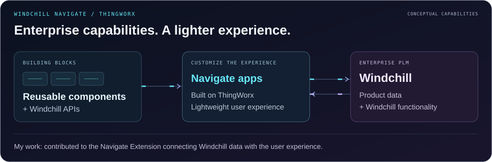



  

<h1>Hi , I'm Nitish.</h1>

<strong>Senior Software Specialist at PTC</strong>

<strong>7.5+ years building web applications. Backend architecture. Enterprise AI integration. Full-stack delivery.</strong>

Enterprise experience: <strong>4.5 years in PTC Windchill development</strong> · Product Lifecycle Management (PLM)

  <a href="https://portfolio.nitishhurduke.workers.dev/"><strong>Explore my work</strong></a>
  &nbsp; / &nbsp;
  <a href="https://www.linkedin.com/in/nitishhurduke/"><strong>Connect on LinkedIn  </strong> </a>
  &nbsp; / &nbsp;
  <a href="mailto:nitishhurduke@gmail.com"><strong>Build with me</strong></a>

---

### The space between a solid system and a great experience.

That's where I like to work.

My core is **Java and Spring Boot**, paired with **Angular and PostgreSQL**. I care about how a system is designed, how its data moves, and how the person on the other side experiences it. Backend depth and frontend polish shouldn't be separate ambitions.

At **PTC**, my work spans **[Windchill](https://www.ptc.com/en/products/windchill) PLM R&D**, **Windchill Navigate on ThingWorx**, **AI agents for Change Management**, and **MCP servers that connect AI clients to Windchill data**.

I bring **end-to-end ownership, system design, and technical leadership** to my broader engineering work. My production AI contributions include a **shared LLM communication layer**, **agent benchmarking with MLflow and Databricks**, and **security checks in CI**.

Based in **Pune, Maharashtra, India**, I am targeting **senior software development roles with architecture ownership and AI engineering responsibilities**, with a long-term goal of becoming a software architect.

[**Resume PDF (draft)**](./assets/resume/nitish-hurduke-resume.pdf) · [**Resume content and LaTeX source**](./assets/resume/README.md) · [**GitHub**](https://github.com/nitishhurduke)

## Selected professional work

### 01  Connect AI clients to enterprise Windchill data

**MCP server development · Parts, Documents & Change Management**  
PTC · Windchill

Contribute to **Model Context Protocol (MCP) server capabilities across three Windchill domains**. These enable MCP-compatible clients, including **Claude** and **GitHub Copilot in VS Code**, to retrieve domain-specific Windchill data in response to user requests.

**Current server configuration: 11 registered tools, not 12.** This describes the server scope, not a claim of sole authorship of every tool.

| Domain server | Tools | Operations |
| :------------ | ----: | :--------- |
| Parts | 5 | Find parts; retrieve parts by identifier; retrieve a BOM; retrieve relationships; find where a part is used |
| Documents | 3 | Find documents; retrieve documents by identifier; retrieve relationships |
| Change Management | 3 | Find change objects; retrieve change objects by identifier; retrieve relationships |

**My ownership:** implement the user validation process, including periodic checks of user information and license validity across the three MCP servers.

**Implementation stack:** Java 21, Spring Boot, blocking Spring Web MVC, Spring AI, and the official MCP Java SDK, with **Streamable HTTP** transport. The integration uses trusted inbound client requests and **mutual TLS** for plugin-to-Windchill communication. Plugin-management API keys are separate from MCP-client authentication.

### 02  AI agents for enterprise Change Management

**Change AI Extension · Windchill PLM R&D**  
PTC · Senior Software Specialist · November 2024–present

Contributed to the **production release** of the Change AI Extension, including the **PR Draft and PR Validator agents**, and implemented a **common LLM communication and response-processing layer used by all three agents**.

- **PR Draft Agent:** turns an end user's problem description into a formatted **Problem Report (PR)** in a reported **10–30 seconds**. This is an observed duration, not a measured percentage improvement over the previous manual process.
- **PR Validator Agent:** checks drafted and existing reports against a **Change Admin template** for completeness and compares them with existing reports for potential duplicates. **Human reviewers retain validation responsibility**; AI indications are not treated as confirmed matches.

**My implementation contributions:**

- Investigated **Windchill REST Services (WRS) APIs** against extension business requirements.
- Implemented the **shared LLM communication and response-processing layer** for all three agents.
- Built the **LLM configuration UI** using Angular.
- Integrated **Checkmarx SAST** and **Black Duck dependency security checks** into CI.
- Implemented **agent benchmark evaluation and usage/behavior reports** using Python, **MLflow**, and **Databricks**.
- Supported project coordination and **Jira effort tracking**.

**Stack:** Spring Boot, Angular, Python, Gradle, and YAML configuration. Model integrations include GPT and Claude families; Microsoft Foundry is used in the development environment.

### 03  Connect enterprise data to the user experience

**Windchill Navigate Extension · ThingWorx**  
PTC · Software Specialist · May 2022–November 2024

Contributed to the **Windchill Navigate Extension**, built on **ThingWorx**. Navigate exposes Windchill functionality through a **lightweight user experience**, with **reusable components and Windchill APIs** for building custom Navigate applications.

**Engineering focus:** connecting enterprise platform capabilities with a customizable user experience.

### 04  Document verification in a finance application

**CDL Lakshmi Finance - Furniture financing · Client project**  
IP Tech System · Software Engineer · January 2019–May 2022

Developed the **Document Verification module** in a client finance application for purchasing furniture on loan.

- Supported **KYC documents, loan sanction letters, disbursement letters**, and other loan-related documents.
- A **clerk personally reviews and approves documents**; the module fetches information from relevant **government APIs to support KYC validation**.
- Tracked verification as **pending, in progress, complete, or failed**. The process moves to the **Disbursement module only after verification is complete and all documents are approved**.

**Engineering focus:** role-based human review, API-assisted verification, and explicit workflow states—not automated document approval.

[**View my professional background on LinkedIn →**](https://www.linkedin.com/in/nitishhurduke/)

## Public work you can explore

### Make the invisible visible

 **Sorting Algorithm Visualizer** · Interactive demo

An Angular application that makes algorithm behavior something you can watch, control, and compare.

- Explore **six sorting algorithms**, from Bubble Sort to Heap Sort.
- Adjust array size, execution speed, and input distribution.
- See comparisons, in-place swaps, auxiliary writes, and array accesses as they happen.

**Engineering focus:** generator-driven execution, Angular Signals, and turning technical complexity into an understandable interface.

[**Open portfolio and launch the visualizer →**](https://portfolio.nitishhurduke.workers.dev/)

<strong>More portfolio showcases: distributed systems &amp; real-time interfaces</strong>

### Design beyond the happy path

**Event-Driven Microservices** · Architecture case study

A distributed banking workflow exploring **Java, Spring Boot, Kafka, and PostgreSQL**. The case study covers SAGA coordination, distributed tracing, and fault tolerance.

**Engineering focus:** service boundaries, cross-service consistency, and what happens when part of a workflow fails.

### Keep the interface in step with the data

**Real-Time Analytics Dashboard** · Frontend showcase

A streaming dashboard combining **Angular, RxJS, WebSockets, and custom charts**, with OnPush change detection.

**Engineering focus:** connecting high-frequency updates to a responsive, readable interface.

The case study and dashboard are described in the portfolio's Projects section; they are not linked here as runnable demos.

[**Explore the portfolio →**](https://portfolio.nitishhurduke.workers.dev/) · Choose **Projects** for the full overview.

## My engineering toolkit

| Layer              | My core stack                  | What interests me                                       |
| :----------------- | :----------------------------- | :------------------------------------------------------ |
| **Backend**        | Java · Spring Boot             | API design, service boundaries, resilient workflows     |
| **Frontend**       | Angular · TypeScript · RxJS    | Reactive interfaces, interaction details, performance   |
| **Data**           | PostgreSQL · SQL               | Data modeling and application consistency               |
| **Delivery**       | Docker · GitHub                | Reproducible environments and collaborative development |
| **Enterprise PLM** | PTC Windchill                  | Product lifecycle management application development    |
| **Integration**    | Windchill Navigate · ThingWorx | Enterprise data access and presentation                 |
| **Applied AI**     | Spring Boot · LLM integration   | Shared communication layer across 3 production agents  |
| **AI evaluation**  | Python · MLflow · Databricks    | Agent benchmarks and usage/behavior reporting           |
| **AI integration** | Spring AI · MCP · Java SDK     | User and license validation across 3 domain servers     |
| **Security & CI**  | Checkmarx · Black Duck · Gradle | Static analysis and dependency security checks          |
| **Exploring**      | Kafka                          | Event-driven systems                                    |

## How I like to build

**Start with the problem.** Understand the user, the constraints, and the trade-offs before choosing the architecture.

**Own the connections.** Think beyond a single component: the interface, API, data model, and failure paths belong to the same experience.

**Make the team stronger.** Share context, mentor, and make design decisions understandable to the next person working on the system.

---

## Let's build something worth using.

Working on a **Java/Spring Boot backend**, a **polished Angular application**, a **Windchill PLM solution**, or **MCP integrations and agentic workflows**? Those are conversations I'd like to have.

I'm open to senior software development opportunities combining **backend architecture, enterprise systems, and AI engineering**.

**Send me the problem you're solving, where you're stuck, and what you'd like to build together.**

[**Connect on LinkedIn  →**](https://www.linkedin.com/in/nitishhurduke/) &nbsp; [**Email me →**](mailto:nitishhurduke@gmail.com) &nbsp; [Read my writing](https://medium.com/@nitishhurduke) &nbsp; [GitHub](https://github.com/nitishhurduke)
